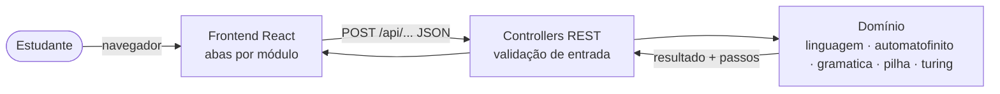
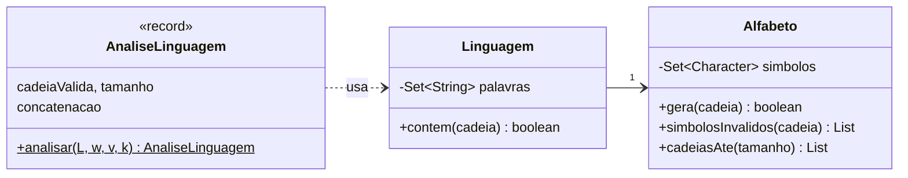
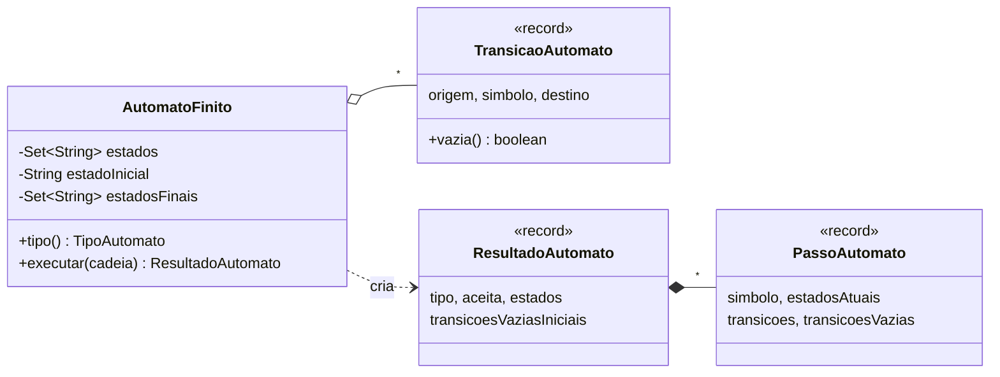
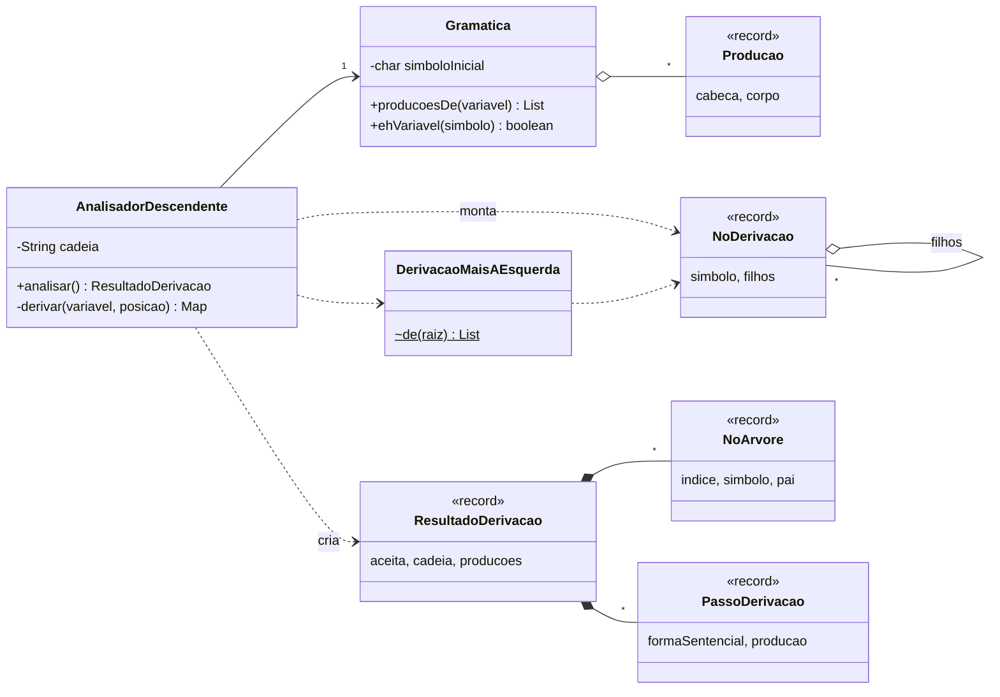
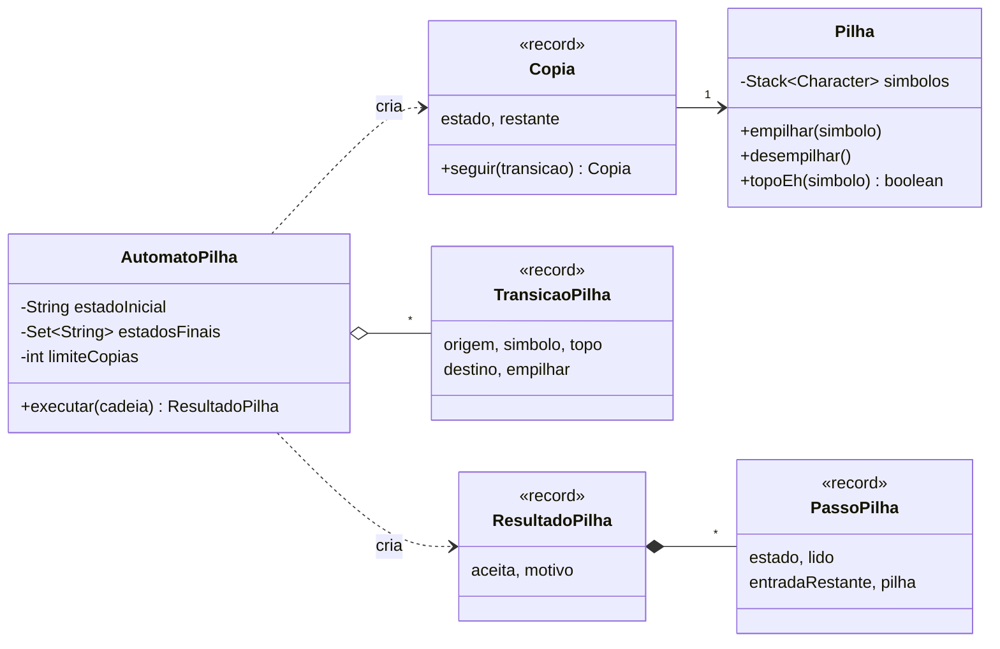
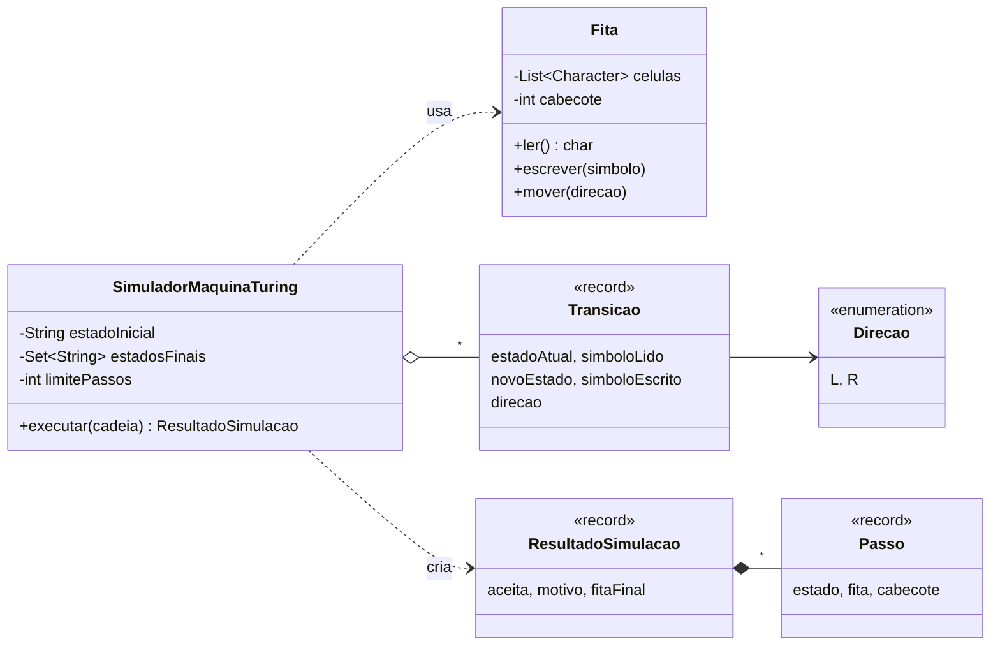
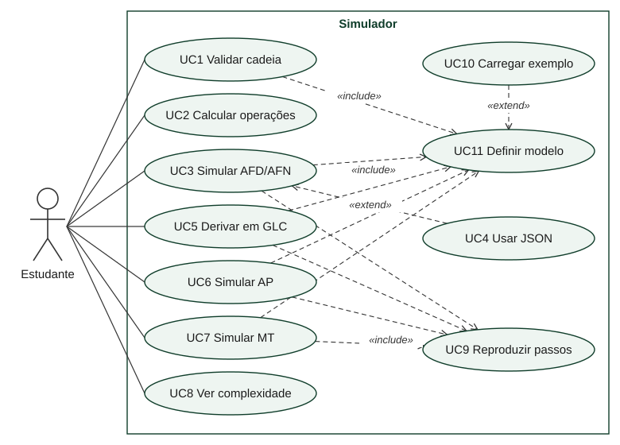

# Simulador de Linguagens Formais e Modelos Computacionais

**Autor:** Artur Lima Santos Bartolelli Resende

**Disciplina:** Aspectos Teóricos da Computação — Universidade de Fortaleza (Unifor)

**Modalidade:** projeto prático (AV3)

**Repositório:** https://github.com/arturbartolelli/lab-teoria-computacao

**Aplicação publicada:** https://lab-teoria-computacao.onrender.com

---

## 1. Introdução

### 1.1 Problema

Estudar Teoria da Computação só no papel tem limites. É fácil escrever um autômato ou uma gramática, mas difícil verificar à mão se o modelo aceita as cadeias certas, e mais difícil ainda acompanhar a execução passo a passo. Em autômatos não determinísticos e autômatos com pilha, várias configurações coexistem. Em máquinas de Turing, a fita muda a cada passo.

O cenário proposto é o de uma empresa de tecnologia educacional que precisa de uma ferramenta em que o estudante informe uma cadeia de entrada e veja o processamento feito por diferentes modelos computacionais.

### 1.2 Objetivos

**Objetivo geral:** desenvolver uma aplicação que permita criar, validar e simular linguagens formais, AFD, AFN, autômatos com pilha, gramáticas livres de contexto e máquinas de Turing, além de analisar a complexidade dos algoritmos usados.

**Objetivos específicos:**

1. Validar cadeias sobre um alfabeto Σ e calcular tamanho, concatenação, Σ\* e Σ⁺.
2. Simular AFD e AFN (com transições ε), mostrando o caminho de estados e aceitando definições em JSON.
3. Decidir se uma cadeia pertence à linguagem de uma GLC, exibindo a derivação mais à esquerda e a árvore de derivação.
4. Simular autômatos com pilha, exibindo leitura, estado e conteúdo da pilha.
5. Simular máquinas de Turing, incluindo as do enunciado: reconhecimento de w#w e soma unária.
6. Determinar o melhor, o médio e o pior caso de cada algoritmo em notação O, Ω e Θ.
7. Oferecer uma interface gráfica em React que exiba estados, pilha e fita de forma visual.

---

## 2. Fundamentação teórica

### 2.1 Linguagens formais

**Alfabeto e cadeias:**
- Um **alfabeto** Σ é um conjunto finito e indivisível de símbolos. Cada símbolo é atômico.
- Uma **cadeia** é uma sequência finita de símbolos de Σ, e |w| é o tamanho de w.
- **λ** é a cadeia vazia, com comprimento zero.

**Σ\* e Σ⁺:** Σ\* é o conjunto de todas as cadeias finitas sobre Σ, incluindo λ. Definição recursiva:
- caso base: λ ∈ Σ\*;
- passo recursivo: se w ∈ Σ\* e a ∈ Σ, então wa ∈ Σ\*.

Σ⁺ é Σ\* sem a cadeia vazia. Como Σ\* é infinito, o simulador o enumera por ordem crescente de comprimento, até um tamanho máximo.

**Concatenação:** combina duas cadeias preservando a ordem dos símbolos. É associativa, não é comutativa, e λ é o elemento neutro: λu = uλ = u. Exemplo: para u = ab e v = ca, uv = abca.

**Linguagem:** uma linguagem formal é um subconjunto de Σ\* definido por regras sintáticas, L = <Σ, S>, com L ⊂ Σ\*. No módulo 1, L é informada pela lista de suas cadeias, e o sistema decide se w ∈ L. Linguagens infinitas são tratadas pelos autômatos e pelas gramáticas.

### 2.2 Autômatos finitos

**AFD:** um autômato finito determinístico é uma 5-upla M = (Q, Σ, δ, q₀, F), onde:
- Q é um conjunto finito de estados;
- Σ é o alfabeto;
- δ: Q × Σ → Q é a função de transição;
- q₀ ∈ Q é o estado inicial;
- F ⊆ Q é o conjunto de estados de aceitação (ou finais).

Para cada par (estado atual, próximo símbolo) está determinado qual é o próximo estado. M aceita w = w₁w₂…wₙ se existe uma sequência de estados r₀, r₁, …, rₙ em que r₀ = q₀, δ(rᵢ, wᵢ₊₁) = rᵢ₊₁ e rₙ ∈ F. A **linguagem de M**, L(M), é o conjunto das cadeias aceitas. No exemplo do enunciado faltam transições; nesse caso a máquina para e a cadeia é rejeitada.

**AFN:** no autômato finito não determinístico, a função de transição é δ: Q × Σε → ℘(Q), com Σε = Σ ∪ {ε}. Com isso:
- um estado pode ter zero, uma ou muitas setas para cada símbolo, e setas com ε;
- ao ler um símbolo, a máquina se divide em cópias que seguem todas as possibilidades em paralelo;
- uma cópia sem seta para o próximo símbolo morre;
- a cadeia é aceita se alguma cópia está em estado de aceitação no final da entrada.

### 2.3 Gramáticas livres de contexto

**Definição:** uma GLC é G = (V, T, P, S), com:
- V as variáveis;
- T os terminais, com V ∩ T = ∅;
- P as produções da forma A → α, com A ∈ V e α ∈ (V ∪ T)\*;
- S ∈ V o símbolo inicial.

**Derivação e linguagem:**
- A relação ⇒ substitui uma variável pelo corpo de uma de suas produções.
- L(G) = { w ∈ T\* | S ⇒\* w }.
- Uma **derivação mais à esquerda** sempre substitui a variável mais à esquerda da forma sentencial.
- A **árvore de derivação** representa a derivação sem a ordem das substituições: a raiz é S, os nós internos são variáveis e as folhas formam w.

O exemplo do enunciado, S → aSb | λ, gera { aⁿbⁿ | n ≥ 0 }. As GLC são a base do analisador sintático, que verifica se uma sequência forma uma estrutura válida e produz a árvore.

### 2.4 Autômatos com pilha

**Definição:** o AP é como um AFN com uma pilha, que provê memória adicional. É uma 6-upla (Q, Σ, Γ, δ, q₀, F), onde Γ é o alfabeto da pilha e δ: Q × Σε × Γε → ℘(Q × Γε).

**Computação:**
- A pilha começa vazia.
- A transição (p, c) ∈ δ(q, a, b) lê a, desempilha b e empilha c. Cada um dos três pode ser ε.
- A cadeia é aceita se, após lê-la inteira, alguma cópia está em um estado de F.

Como a pilha começa vazia, os exemplos empilham $ no início para reconhecer o fundo. A linguagem mínima pedida, { aⁿbⁿ | n ≥ 1 }, não é regular: é preciso a pilha para contar os a.

### 2.5 Máquinas de Turing

**Definição:** uma MT é uma 7-upla (Q, Σ, Γ, δ, q₀, qaceita, qrejeita), onde:
- Σ é o alfabeto de entrada, sem o símbolo em branco;
- Γ é o alfabeto da fita, com o branco em Γ e Σ ⊆ Γ;
- δ: Q × Γ → Q × Γ × {E, D} é a função de transição.

No simulador o branco é B, e as direções esquerda e direita são L e R, como no código feito em aula.

**Funcionamento:**
- A **configuração** é a situação da máquina: estado atual, conteúdo da fita e posição da cabeça. É o que a tela mostra a cada passo.
- A máquina aceita ao entrar no estado de aceitação.
- Um símbolo sem transição definida leva implicitamente a qrejeita.
- Uma linguagem é **Turing-reconhecível** se alguma MT a reconhece, e **Turing-decidível** se alguma MT a decide, isto é, sempre para.

Uma MT pode nunca parar. Por isso o simulador tem um **limite de passos** e classifica como **INDETERMINADA** a execução que o atinge.

**Cálculo de funções:** a MT também calcula funções sobre inteiros em unário. O inteiro i é 0ⁱ, e os argumentos são separados por 1. A soma recebe 0ᵃ10ᵇ e deixa 0ᵃ⁺ᵇ na fita.

---

## 3. Arquitetura

### 3.1 Visão geral

A solução é um monorepo com duas aplicações:

| Camada | Tecnologia | Responsabilidade |
| ------ | ---------- | ---------------- |
| Backend | Java 21, Spring Boot 4, Bean Validation | domínio, algoritmos e API REST (JSON) |
| Frontend | React 19, TypeScript, Vite | edição dos modelos, chamadas à API e visualização passo a passo |
| Implantação | Docker, Render | imagem única: o Spring Boot serve o frontend compilado e a API no mesmo domínio |



O backend é organizado **por módulo**: `linguagem`, `automatofinito`, `gramatica`, `pilha`, `turing`, mais um pacote `compartilhado`. Cada módulo tem duas camadas:

- **`dominio`**: classes puras de Java, sem dependência de Spring, que modelam o formalismo e executam o algoritmo. São testadas de forma isolada.
- **`api`**: records de requisição com validação declarativa (`@NotBlank`, `@Pattern`, `@Size`) e um controller que converte a requisição em objeto de domínio e devolve o resultado.

O frontend segue a mesma divisão (`src/modulos/<módulo>`) e concentra em `src/compartilhado` os componentes reutilizáveis: tabela de regras, reprodução passo a passo, diagrama de estados, painel JSON e log de passos.

### 3.2 Diagrama de classes (domínio)

Cada módulo tem seu diagrama. Os controllers e records de requisição da camada `api` foram omitidos: cada controller converte a requisição e chama a operação principal do módulo.

**Linguagens formais**



**Autômatos finitos**



**Gramáticas livres de contexto**



**Autômato com pilha**



**Máquina de Turing**



### 3.3 Casos de uso



| Caso de uso | Fluxo principal | Fluxos alternativos |
| ----------- | --------------- | ------------------- |
| UC1 Validar cadeia | 1. estudante informa Σ, L e w; 2. sistema verifica w ∈ Σ\* e w ∈ L; 3. exibe veredito e tamanho | símbolo fora de Σ → posição destacada; palavra de L fora de Σ → HTTP 422 |
| UC2 Calcular operações | 1. estudante informa v e o tamanho máximo; 2. sistema exibe w·v, Σ\* e Σ⁺ | mais de 2000 cadeias → HTTP 422 |
| UC3 Simular AFD/AFN | 1. estudante informa estados, inicial, finais, transições e cadeia; 2. sistema classifica como AFD ou AFN; 3. simula e exibe veredito, caminho e diagrama | estado não declarado → HTTP 422; campo inválido → mensagem por campo (HTTP 400) |
| UC4 Usar JSON | estende UC3: 1. estudante abre o painel JSON; 2. cola ou abre um arquivo; 3. sistema preenche o formulário; também exporta o modelo atual | JSON malformado, campo ausente ou de tipo errado → mensagem, formulário inalterado |
| UC5 Derivar em GLC | 1. estudante informa V, T, S, produções e cadeia; 2. sistema aplica a descida recursiva; 3. se aceita, exibe derivação e árvore | símbolo não declarado ou recursão à esquerda → HTTP 422; cadeia fora de L(G) → REJEITADA |
| UC6 Simular AP | 1. estudante informa o AP e a cadeia; 2. sistema segue todas as cópias em paralelo; 3. exibe leitura, estado e pilha a cada passo da cópia que aceitou | nenhuma cópia aceita → REJEITADA, com a que mais avançou; limite de cópias → INDETERMINADA |
| UC7 Simular MT | 1. estudante define a máquina ou escolhe w#w ou soma unária; 2. sistema executa até parar; 3. exibe veredito, fita final e animação | transições duplicadas → HTTP 422; limite de passos → INDETERMINADA |
| UC8 Ver complexidade | 1. estudante abre a aba; 2. sistema exibe melhor, médio e pior caso com justificativa | — |
| UC9 Reproduzir passos | incluído em UC3, UC5, UC6 e UC7: avançar, voltar, reproduzir, pausar e ajustar a velocidade | — |
| UC10 Carregar exemplo | estende UC11: preenche o formulário com um modelo pronto | — |
| UC11 Definir modelo | incluído em UC1, UC3, UC5, UC6 e UC7: preencher os campos e as regras do modelo | — |

---

## 4. Implementação

### 4.1 Estruturas de dados

| Estrutura | Onde | Por quê |
| --------- | ---- | ------- |
| `LinkedHashSet<Character>` | `Alfabeto` | consulta em tempo constante, preservando a ordem de Σ para a enumeração |
| `List<Transicao>` | autômato finito e AP | função de transição como lista de regras |
| `TreeSet<String>` de estados ativos | simulação de AFN | estados em que há uma cópia do AFN, sem repetição e em ordem |
| `Map` de posição final → árvore | `AnalisadorDescendente` | guarda até onde cada variável consegue ler a partir de uma posição, para não repetir o cálculo |
| `Stack<Character>` | `Pilha` | empilhar e desempilhar no topo |
| `Queue<Copia>` | `AutomatoPilha` | cópias da máquina que ainda vão continuar |
| `ArrayList<Character>` + índice do cabeçote | `Fita` | expansão nas duas pontas, simulando a fita infinita |
| `Map<ChaveTransicao, Transicao>` | `SimuladorMaquinaTuring` | consulta a δ(q, a) em tempo constante e detecção de não determinismo na construção |

Os resultados (`ResultadoAutomato`, `ResultadoDerivacao`, `ResultadoPilha`, `ResultadoSimulacao`) são `record`s imutáveis. Eles carregam a lista de passos que o frontend reproduz, então a interface não recalcula nada do modelo.

### 4.2 Algoritmos

**Linguagens formais:**
- **Validação:** cada símbolo de w é consultado no conjunto Σ, e todas as posições inválidas são reportadas.
- **Σ\* e Σ⁺:** a enumeração é feita por camadas. É o passo recursivo da definição: de cada cadeia w de tamanho k e cada símbolo a, obtém-se wa, de tamanho k + 1. Como o crescimento é exponencial, a API recusa pedidos com mais de 2000 cadeias.

**AFD/AFN:** `atuais` guarda os estados em que há uma cópia da máquina.
```
atuais ← {q₀} e os estados alcançados por ε
para cada símbolo a de w:
    se atuais = ∅: pare (rejeita)
    atuais ← destinos de cada cópia lendo a, e os alcançados por ε
aceita ← (w foi consumida) ∧ (atuais ∩ F ≠ ∅)
```
Em um AFD, `atuais` tem sempre no máximo um estado, e o caminho é exibido como `q0 → q1 → q2`. Cada passo registra as transições lidas e as transições ε seguidas. O tipo é classificado automaticamente: o autômato é AFN se houver transição ε ou dois destinos para o mesmo par (estado, símbolo).

**GLC, descida recursiva:** é a técnica do analisador sintático (parser) de expressões feito em aula, em que cada variável da gramática é um método. Como aqui a gramática é digitada pelo usuário, há um único método, que recebe a variável e lê as produções dela:
```
DERIVAR(variável, posição):
    para cada produção da variável:
        para cada símbolo do corpo:
            terminal: compara com o próximo símbolo da cadeia
            variável: chama DERIVAR(variável, posição atual)
        se todos os símbolos casaram: guarda a árvore e a posição final
```
- Se uma produção não serve, as outras são tentadas. A cadeia é aceita se DERIVAR(S, 0) chega ao fim dela.
- O resultado de cada par (variável, posição) é guardado para não ser recalculado.
- **Recursão à esquerda:** em E → E+T, DERIVAR(E, 0) chamaria DERIVAR(E, 0) sem ler nada e nunca terminaria. O sistema detecta o caso e pede para reescrever a produção, como E → TX e X → +TX | λ.
- Cada chamada cria um nó, então a árvore fica pronta ao final. A derivação mais à esquerda sai dela, expandindo sempre a variável mais à esquerda.

**Autômato com pilha:** cada cópia tem seu estado, sua entrada restante e sua pilha.
```
cópias ← fila com (q₀, w, pilha vazia)
enquanto houver cópias:
    c ← primeira da fila
    se c leu tudo e seu estado ∈ F: ACEITA
    para cada transição aplicável a c:
        crie uma nova cópia: lê, desempilha, empilha, muda de estado
REJEITADA
```
Uma cópia sem transição aplicável simplesmente não gera outras: ela morre. O limite de 5000 cópias interrompe laços de ε e o crescimento exagerado (INDETERMINADA).

**Máquina de Turing:**
```
estado ← q₀; fita ← B·w·B; cabeçote ← 1
enquanto estado ∉ F:
    se passos = limite: INDETERMINADA
    t ← δ(estado, fita[cabeçote])
    se t indefinida: REJEITADA
    registra passo; escreve; move (L ou R); estado ← destino
ACEITA
```
A fita cresce sob demanda nas duas pontas. As máquinas do enunciado têm testes automatizados:

| Máquina | Estratégia | Transições | Testes |
| ------- | ---------- | ---------- | ------ |
| Opção A, L = { w#w } | zigue-zague em torno do #: marca com x o próximo símbolo de w, "lembra" se era 0 ou 1 pelo estado (q2/q3) e marca o correspondente depois do #; no fim, verifica que só restam x | 22 | aceita `#`, `0#0`, `0110#0110`, `101#101` e \|w\| = 49; rejeita `0#1`, `01#0`, `0#01`, `0#0#0` |
| Opção B, soma unária | troca o separador 1 por 0, vai até o fim e apaga um 0 | 5 | `000100` (3 + 2) → `00000`; `0001`, `100` e `1` (operando vazio) |

A opção A usa Σ = {0, 1, #}. Ela dá 2|w|² + 4|w| + 2 passos, então o limite de 5000 alcança |w| ≤ 49; acima disso, o veredito é INDETERMINADA.

### 4.3 Validação e tratamento de erros

**Formato (HTTP 400):** os records de requisição validam o formato com Bean Validation:
- símbolo com um único caractere não-espaço;
- limites de tamanho.

Os erros voltam como `ProblemDetail`, com a lista `erros` por campo. JSON malformado ou direção diferente de L e R falha na leitura do corpo e volta só com a mensagem geral. O frontend converte o índice `transicoes[0]` para a numeração exibida na tabela (`transicoes 01`).

**Consistência (HTTP 422):** a consistência semântica é verificada no domínio e gera `ModeloInvalidoException`. Exemplos:
- estado do autômato finito fora de Q;
- MT não determinística;
- produção com símbolo não declarado ou recursão à esquerda;
- palavra de L fora de Σ.

### 4.4 Interface

A interface tem uma aba por módulo, com visual de terminal. A aba de complexidade é um painel único de consulta. As demais têm dois painéis:

**Definição:**
- campos do modelo, com exemplos prontos;
- tabela de regras no formato da notação formal, por exemplo `δ(q2, b, a) = (q3, ε)` (exceto em linguagens);
- painel de importação e exportação em JSON, na aba de autômatos finitos.

**Saída:**
- veredito (ACEITA, REJEITADA ou INDETERMINADA);
- visualização específica do módulo:
  - linguagens: símbolos inválidos destacados e Σ\* e Σ⁺ enumerados;
  - AFD/AFN: entrada consumida e diagrama de estados em SVG, com estados ativos e transições usadas (inclusive ε) destacados;
  - GLC: derivação e árvore desenhada em texto;
  - AP: pilha vertical e tabela de leitura, estado e pilha;
  - MT: fita com cabeçote;
- controles de reprodução (início, anterior, reproduzir/pausar, próximo, fim, velocidade) em autômatos, GLC, AP e MT, sincronizados com a lista de passos.

Esses itens atendem ao bônus: os estados dos autômatos, a pilha do AP e a fita da MT são exibidos visualmente.

### 4.5 Testes

| Camada | Ferramenta | Cobertura |
| ------ | ---------- | --------- |
| Domínio Java | JUnit 5 | Σ e L, AFD/AFN (inclusive ε), GLC (derivação, árvore, λ, expressões, recursão à esquerda recusada), AP (pilha passo a passo, rejeições, não determinismo, limite de cópias), MT (fita, w#w e soma unária) |
| API | Spring MockMvc | validação 400, modelo inválido 422 e serialização em autômatos finitos, gramáticas e MT |
| Frontend | Vitest + `tsc` + oxlint | conversão formulário ↔ JSON (ida e volta, campo ausente), ε/λ, alternativas com \|, caminho do AFD, desenho da árvore |

---

## 5. Análise de complexidade

### 5.1 Método

- Usamos a Máquina de Acesso Aleatório (RAM): as instruções são executadas uma após a outra, e cada linha tem custo constante cᵢ.
- O tempo de execução T(n) é a soma de custo × número de vezes de cada linha.
- **Tamanho da entrada:** n = |w|. O modelo (estados, transições, produções) é fixo e entra como constante.
- **Ordem de crescimento:** fica só o termo dominante de T(n), sem o coeficiente.
- **Notações:** Ω para o melhor caso (limite assintótico inferior), O para o pior caso (limite assintótico superior) e Θ quando o limite é estrito.
- **Caso médio:** usamos o caso típico, indicado na justificativa. Em geral, ele é tão ruim quanto o pior caso.

Formalmente, f(n) = O(g(n)) se existem constantes positivas c e n₀ tais que 0 ≤ f(n) ≤ c·g(n) para todo n ≥ n₀; f(n) = Ω(g(n)) se 0 ≤ c·g(n) ≤ f(n); e f(n) = Θ(g(n)) se valem as duas.

### 5.2 Análise linha a linha

**Validação de w ∈ Σ\*.** Seja t o número de símbolos inválidos, 0 ≤ t ≤ n.

| VALIDA(w, Σ) | custo | vezes |
| ------------ | ----- | ----- |
| 1. inválidos ← ∅ | c₁ | 1 |
| 2. para i ← 1 até n | c₂ | n + 1 |
| 3. &nbsp;&nbsp;&nbsp;se w[i] ∉ Σ | c₃ | n |
| 4. &nbsp;&nbsp;&nbsp;&nbsp;&nbsp;&nbsp;insira i em inválidos | c₄ | t |
| 5. devolva inválidos | c₅ | 1 |

- T(n) = c₁ + c₂(n + 1) + c₃n + c₄t + c₅
- **Melhor caso** (t = 0): T(n) = (c₂ + c₃)n + (c₁ + c₂ + c₅), que é Ω(n).
- **Pior caso** (t = n): T(n) = (c₂ + c₃ + c₄)n + (c₁ + c₂ + c₅), que é O(n).
- Como é Ω(n) e O(n), o algoritmo é **Θ(n)**.

**Simulação de AFD.** Seja t o número de símbolos lidos, 1 ≤ t ≤ n.

| SIMULA-AFD(w) | custo | vezes |
| ------------- | ----- | ----- |
| 1. q ← q₀ | c₁ | 1 |
| 2. i ← 1 | c₂ | 1 |
| 3. enquanto i ≤ n e q existe | c₃ | t + 1 |
| 4. &nbsp;&nbsp;&nbsp;q ← δ(q, w[i]) | c₄ | t |
| 5. &nbsp;&nbsp;&nbsp;i ← i + 1 | c₅ | t |
| 6. devolva i > n e q ∈ F | c₆ | 1 |

- T(n) = c₁ + c₂ + c₃(t + 1) + (c₄ + c₅)t + c₆
- **Melhor caso** (t = 1, não há transição para o primeiro símbolo): T(n) é constante, **Ω(1)**.
- **Pior caso** (t = n): T(n) = (c₃ + c₄ + c₅)n + (c₁ + c₂ + c₃ + c₆), **O(n)**.
- **AFN:** a linha 4 vira um laço pelas cópias. Há no máximo uma por estado, e |Q| é constante, então o pior caso continua O(n).

**Máquina w#w.** Contamos os passos da máquina. Seja m = |w|, com n = 2m + 1.

| Etapa | passos |
| ----- | ------ |
| marca o símbolo e anda até o correspondente, m vezes | m(m + 1) |
| marca o correspondente, m vezes | m |
| volta até a marca e avança, m vezes | m(m + 1) |
| confere que só restam x | m + 2 |

- Soma: 2m² + 4m + 2. Trocando m por (n − 1)/2: **T(n) = n²/2 + n + 1/2**. Para `0110#0110`, n = 9 e T(9) = 50 passos, o mesmo valor que o simulador mostra.
- Termo dominante n²/2, então a ordem de crescimento é **Θ(n²)** para cadeias da linguagem. O melhor caso é Ω(1): o primeiro símbolo é inválido e a máquina para.
- **Soma unária:** atravessa a entrada uma vez, T(n) = n + 2, Θ(n). Para `000100`, T(6) = 8 passos.

### 5.3 Resumo

| Algoritmo | Melhor caso | Caso médio | Pior caso | Justificativa |
| --------- | ----------- | ---------- | --------- | ------------- |
| Validação de w ∈ Σ\* | Ω(n) | Θ(n) | O(n) | Um laço que passa por todos os símbolos, mesmo quando já achou um inválido. Melhor e pior caso têm a mesma ordem. |
| Pertinência w ∈ L | Ω(n) | Θ(n) | O(n) | L é fixa e finita. Ler w e comparar com palavras de L custa um número constante de passos por símbolo. |
| Concatenação w·v | Ω(n) | Θ(n) | O(n) | Aqui n = \|w\| + \|v\|. Cada símbolo é copiado uma vez. |
| Enumeração de Σ\* até tamanho n | Ω(n·\|Σ\|ⁿ) | Θ(n·\|Σ\|ⁿ) | O(n·\|Σ\|ⁿ) | Para \|Σ\| ≥ 2 são geradas todas as cadeias, da ordem de \|Σ\|ⁿ, com até n símbolos cada. Custo exponencial, por isso há o limite de 2000 cadeias. |
| Simulação de AFD | Ω(1) | Θ(n) | O(n) | Um laço, um passo por símbolo. Melhor: não há transição para o primeiro símbolo. Médio e pior: lê a cadeia inteira. |
| Simulação de AFN | Ω(1) | Θ(n) | O(n) | O mesmo laço do AFD, com um laço interno pelas cópias em paralelo, no máximo uma por estado. O número de estados é constante, então a ordem não muda. |
| Descida recursiva | Ω(1) | Θ(n) | O(n³) | Melhor: o primeiro símbolo já não serve. Médio: gramática do enunciado com w = aᵐbᵐ, uma chamada por nível. Pior: n posições e, em cada produção, dois laços aninhados pelos pontos onde cada símbolo pode terminar. |
| Árvore e derivação | Ω(n) | Θ(n²) | O(n²) | Melhor: uma produção gera w de uma vez, e só é preciso escrevê-la. Médio e pior: da ordem de n passos, e cada um reescreve a forma sentencial, com até n símbolos. |
| Simulação de AP | Ω(1) | Θ(n²) | O(kⁿ) | Melhor: nenhuma cópia consegue ler o início, como ba em aⁿbⁿ. Médio: aⁿbⁿ, da ordem de n cópias, e cada uma copia a pilha e a entrada restante, com até n símbolos. Pior: cada símbolo divide a máquina em mais cópias, e a quantidade cresce exponencialmente (k é constante do autômato). Por isso há o limite de 5000 cópias. |
| Simulação de MT | Ω(n) | Θ(n²) | sem limite | Melhor: copia a entrada para a fita e para. Médio: máquina que dá n passos, como a soma, e copia a fita em cada um. Pior: a máquina pode não parar (problema da parada), então o simulador corta em 5000 passos. |
| Máquina w#w (passos) | Ω(1) | Θ(n²) | O(n²) | Melhor: o primeiro símbolo é inválido. Médio e pior: cadeia da linguagem, um vaivém na fita para cada símbolo de w. T(n) = n²/2 + n + 1/2. |
| Soma unária (passos) | Ω(1) | Θ(n) | O(n) | Melhor: entrada que começa com 11, para no segundo símbolo. Médio e pior: atravessa a fita uma vez. T(n) = n + 2. |

### 5.4 Tratáveis, intratáveis e insolúveis

- **Polinomiais (tratáveis):** validação, pertinência, concatenação, AFD, AFN, descida recursiva, árvore, w#w e soma unária. Os problemas de decisão correspondentes estão na classe P.
- **Exponenciais:** a enumeração de Σ\* e o pior caso do AP não determinístico. Os limites de 2000 cadeias e de 5000 cópias mantêm o tempo aceitável.
- **Insolúvel:** saber se uma MT qualquer para é o Problema da Parada. Por isso há o limite de 5000 passos e o veredito INDETERMINADA, que é diferente de REJEITADA.

---

## 6. Conclusão

O projeto entregou uma ferramenta web que cobre os seis módulos do enunciado: linguagens formais, autômatos finitos, gramáticas livres de contexto, autômatos com pilha, máquinas de Turing e complexidade.

**Algoritmos e garantias:**
- Os algoritmos são gerais, não casos fixos. O usuário define seus próprios AFD, AFN, GLC sem recursão à esquerda, AP e MT determinística, com símbolos de um caractere e dentro dos limites de tamanho: cadeia de até 500 símbolos (100 na GLC), 500 transições e 200 produções.
- As máquinas pedidas no enunciado (w#w e soma unária) vêm como exemplos e têm testes automatizados.
- A separação entre domínio puro, API validada e interface permitiu testar cada algoritmo isoladamente.
- Cada modelo devolve a lista de passos da execução, e o mesmo componente de reprodução a percorre em autômatos finitos, GLC, AP e MT.

**Teoria aplicada no código:**
- As cópias em paralelo do não determinismo aparecem no AFN e no AP.
- O Problema da Parada justifica o limite de passos e o veredito INDETERMINADA na MT.
- A análise assintótica orientou escolhas concretas: guardar resultados na descida recursiva e limitar a enumeração de Σ\* e as cópias do AP.

---

## Referências

- UNIVERSIDADE DE FORTALEZA. *Sistemas Formais e Alfabetos*. Slides de aula.
- UNIVERSIDADE DE FORTALEZA. *Aspectos Teóricos da Computação*: Unidade I – Autômatos Finitos. Slides de aula.
- UNIVERSIDADE DE FORTALEZA. *Aspectos Teóricos da Computação*: Unidade I – Autômatos Finitos com Pilha. Slides de aula.
- UNIVERSIDADE DE FORTALEZA. *Aspectos Teóricos da Computação*: Unidade II – Máquina de Turing. Slides de aula.
- UNIVERSIDADE DE FORTALEZA. *Aspectos Teóricos da Computação*: Unidade II – Máquina de Turing: Cálculo de Funções. Slides de aula.
- UNIVERSIDADE DE FORTALEZA. *Aspectos Teóricos da Computação*: Unidade II – Complexidade de Algoritmos, partes 1 a 3. Slides de aula.
